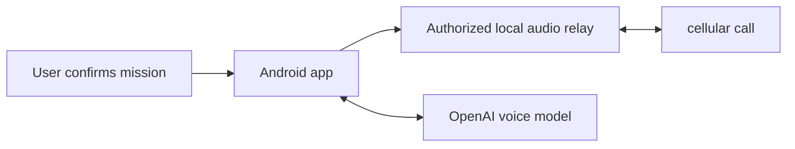

# Appel AI

**An Android AI assistant for consented cellular calls.** Prepare a mission, let the assistant participate and retain manual control.

[Français](README.fr.md) · Created by **Charadi Badr** · MIT application code

> **Experimental — physical tests only on the author’s Pixel 8 Pro, using the OpenAI API. Other phones and providers are not validated.**

[**Download APK 0.16**](https://github.com/iasibadr/appel-ai/releases/download/v0.16/appel-ai-0.16.apk) · [**Installation guide**](docs/INSTALLATION.md) · [**Help test Android phones**](https://github.com/iasibadr/appel-ai/issues/2)

The badge covers configured source checks, not real-device audio or a security certification. Known lint findings are listed below.

## What it does

- Configure a mission and use an explicitly authorized local audio relay.
- Choose OpenAI **Economique (Mini)** or **Complet**; [compare their prices](docs/VOICE_PROVIDERS.md).
- Use your own API credentials. The relay runs on the phone; voice processing uses OpenAI over the Internet. This is not an offline AI model.

This is an independent community project, not an official OpenAI product.

## What has actually been verified

| Area | Current evidence |
|---|---|
| Physical phone | Author’s Pixel 8 Pro only |
| Provider | OpenAI API only; not every model/scenario separately certified |
| Local relay | Startup observed on Pixel 8 Pro / Android 17 |
| Complete call audio | A ready indicator does not prove remote audio; further consented reports needed |
| Other phones / full reboot recovery | Not established |

Original APK uses an Android development certificate. Source checks: 72 JUnit tests; lint has 0 errors and 74 warnings. See [validation](docs/VALIDATION.md), [audit](AUDIT.md) and [compatibility reports](docs/COMPATIBILITY.md).

## Before installing

Read [setup requirements](docs/INSTALLATION.md) and [privacy and permissions](docs/PRIVACY.md). Local wireless-debugging pairing grants shell-level capabilities; microphone permission alone is insufficient. Never bypass permission checks or import another person’s credentials. Test with an informed, consenting participant and retain manual control.

The supplied APK is preserved unchanged. Check its [SHA-256](downloads/SHA256SUMS) and [release notes](docs/RELEASE_NOTES.md).

## Join the project

- **Test another phone:** report the model, Android/app version and what passed, failed or was not tested in the [testing thread](https://github.com/iasibadr/appel-ai/issues/2). Failures are useful too.
- **Help improve the guide:** browse [beginner-friendly tasks](https://github.com/iasibadr/appel-ai/issues?q=is%3Aissue%20is%3Aopen%20label%3A%22good%20first%20issue%22).
- **Request another voice provider:** use the [request form](https://github.com/iasibadr/appel-ai/issues/new?template=voice_provider_request.md). Integration depends on feasibility, contributors and testing; no delivery date is promised.
- **Report a bug:** use [Issues](https://github.com/iasibadr/appel-ai/issues/new/choose). See [support](SUPPORT.md) for help and [security reporting](SECURITY.md) for vulnerabilities.

Do not post API keys, contacts, phone numbers, pairing codes, private conversations, recordings or unreviewed device logs.

## Developer resources

[Build from source](docs/BUILD.md) · [Contribute](CONTRIBUTING.md) · [Roadmap](docs/ROADMAP.md) · [Changelog](CHANGELOG.md) · [Third-party notices](THIRD_PARTY_NOTICES.md)

Related project: [WhatsApp AI](https://github.com/iasibadr/whatsapp-ai).

Keywords: `android`, `ai-calling`, `ai-voice-agent`, `openai-realtime-api`, `adb`, `apk`, `telephony`.
